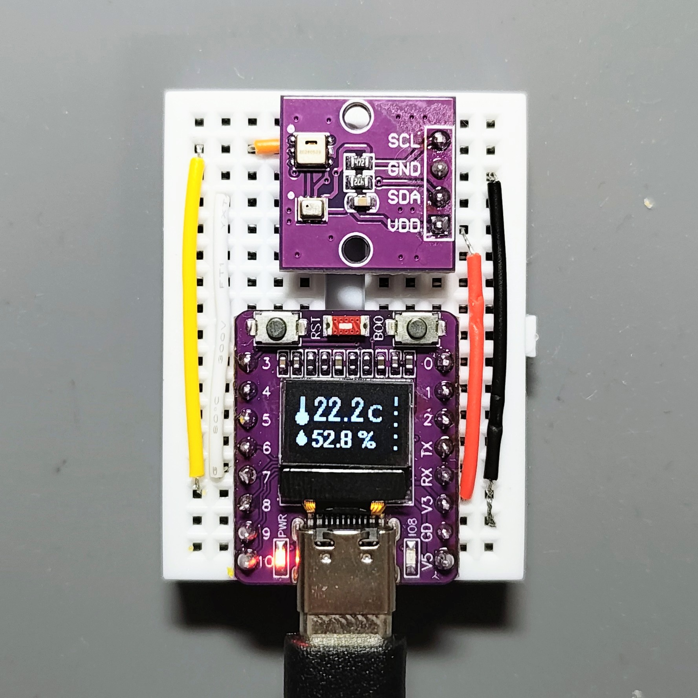
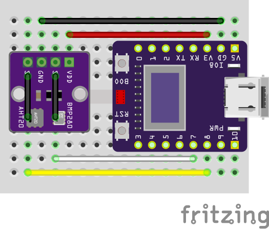

# ESP32 Temperature, Humidity, and Pressure Monitor



ESP32-C3とOLEDディスプレイ、AHT20・BMP280センサーを使った環境モニターです。
温度、湿度、気圧を定期的に取得し、OLEDに自動で切り替えながら表示します。

## 主な機能

- 温度・相対湿度・気圧のリアルタイム表示
- 過去に取得した温度の簡易グラフ表示
- 体感温度（DI）と露点の表示
- 起動後の温度・湿度・気圧の最低値／最高値表示
- 気圧の変化から天候の傾向を表示
- センサーが見つからない場合のエラー表示

画面は約7秒ごとに切り替わります。温度・湿度は1秒ごと、温度履歴は30秒ごと、
気圧履歴は10分ごとに更新します。気圧の傾向は、十分な履歴がたまるまで
`Wait 30min` と表示されます。

## 必要な部品

- ESP32-C3 OLEDボード
- AHT20（温湿度センサー）
- BMP280（気圧センサー）
- ブレッドボード
- ジャンパーワイヤー

## 配線

 
OLEDとセンサーは別のI2Cピンを使用します。

| 接続先 | VCC | GND | SDA | SCL |
| --- | --- | --- | --- | --- |
| OLED | 3V3 | GND | GPIO5 | GPIO6 |
| AHT20 / BMP280 | 3V3 | GND | GPIO7 | GPIO8 |

センサーはI2Cアドレス `0x76`、または `0x77` のBMP280に対応しています。

## 開発環境

- [PlatformIO](https://platformio.org/)
- Arduino framework
- `espressif32`（ボード: `esp32-c3-devkitm-1`）
- USB接続可能なESP32-C3ボード

依存ライブラリは [platformio.ini](platformio.ini) に定義されています。

## ビルドと書き込み

1. このリポジトリを取得し、VS Codeで開きます。
2. PlatformIOをインストールします。
3. USBでESP32-C3を接続します。
4. PlatformIOの **Build** でビルドします。
5. **Upload** でファームウェアを書き込みます。

PlatformIO CLIを使う場合は、リポジトリのルートで次を実行します。

```sh
pio run
pio run --target upload
```

シリアルモニターを使用する場合の通信速度は115200 baudです。

```sh
pio device monitor --baud 115200
```

## トラブルシューティング

- `AHT20 NG` または `BMP280 NG` と表示される場合は、電源、GND、SDA、SCLの配線を確認してください。
- センサー側のSDA/SCLはGPIO7/GPIO8、OLED側はGPIO5/GPIO6です。配線を混同しないでください。
- BMP280が `0x76` と `0x77` のどちらで動作しているかを確認してください。
- 表示が崩れる場合は、OLEDの電源電圧とI2C配線を確認してください。

## ライセンス

このリポジトリの自作ソースコードは、[LICENSE.md](LICENSE.md) に記載された
個人利用限定ライセンスの対象です。学習、研究、趣味の電子工作、個人利用を目的とした
改変と組み込みは許可されていますが、商用利用、キットや製品としての販売、
ソースコードや改変版の再配布は、著作権者の事前の許可なく行えません。

PlatformIOで利用する第三者ライブラリには、それぞれのライセンスが適用されます。
第三者ライブラリの利用条件については各ライブラリの配布元を確認してください。